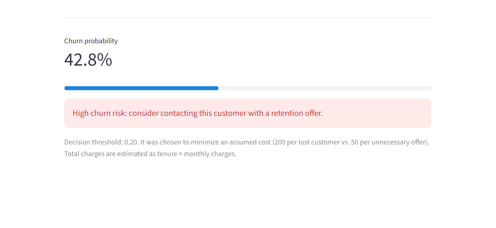
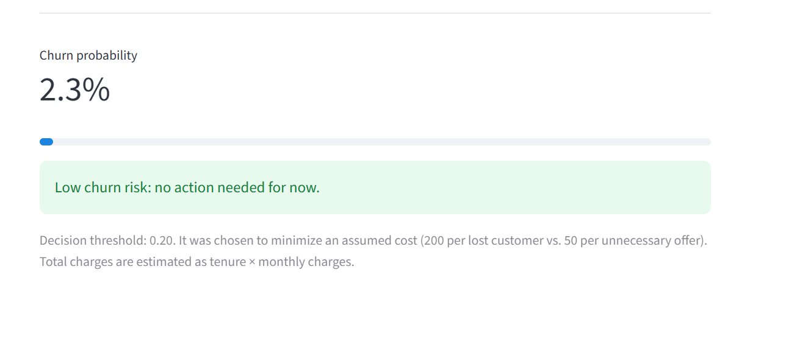

[](https://telecom-churn-prediction-moji.streamlit.app/)

**Live demo:** https://telecom-churn-prediction-moji.streamlit.app/

*The free hosting puts the app to sleep when idle. If you see a "wake up" button, click it and wait a few seconds.*

# Telecom Customer Churn Prediction

End-to-end churn prediction project: from exploratory analysis and model comparison to a
Streamlit app that estimates the churn risk of a single customer.

## Problem

A telecom company loses about 27% of its customers. Retention offers cost money, so the
goal is not just to predict churn but to decide **whom to contact** so that the total cost
(lost customers + unnecessary offers) is minimized.

## Data

[Telco Customer Churn](https://www.kaggle.com/datasets/blastchar/telco-customer-churn)
dataset: 7,043 customers, 20 features (demographics, services, contract, billing).
The target `Churn` is imbalanced (~73% No / ~27% Yes).

## Approach

1. **Cleaning:** 11 customers with blank `TotalCharges` all had `tenure = 0` (new customers),
   so the value was set to 0 instead of dropping the rows.
2. **Preprocessing pipeline:** `ColumnTransformer` (MinMax scaling, one-hot encoding with fixed
   categories, passthrough for binary columns) inside a single `Pipeline`, so training and the
   app use identical preprocessing and no information leaks from the test set.
3. **Imbalance handling:** class weights, random under/over-sampling and SMOTENC were compared
   with 5-fold stratified cross-validation. They changed precision/recall but not ranking quality
   (ROC-AUC ≈ 0.85 for all), so they only move the decision threshold.
4. **Model comparison (CV):** Logistic Regression, Random Forest, Gradient Boosting.

| Model | ROC-AUC | PR-AUC |
|---|---|---|
| Logistic Regression | 0.849 ± 0.010 | 0.660 ± 0.019 |
| Random Forest | 0.848 ± 0.012 | 0.659 ± 0.024 |
| Gradient Boosting | 0.835 ± 0.014 | 0.634 ± 0.025 |

   Logistic regression was selected: same quality as the more complex models, faster and interpretable.
5. **Threshold selection:** chosen on out-of-fold training predictions by minimizing an assumed
   business cost (200 per lost customer, 50 per unnecessary offer) → threshold = 0.2.

## Results (held-out test set, 1,409 customers)

| Strategy | Recall | Precision | Total cost |
|---|---|---|---|
| Contact nobody | 0.000 | - | 74,800 |
| Contact everyone | 1.000 | 0.265 | 51,750 |
| Model, threshold 0.5 | 0.511 | 0.652 | 41,700 |
| **Model, threshold 0.2** | **0.810** | **0.454** | **32,450** |

With the chosen threshold the model finds 81% of churners and reduces the assumed cost by
about 57% compared to doing nothing and about 37% compared to contacting everyone.
Test ROC-AUC: 0.828, PR-AUC: 0.628.

## Streamlit app




The app takes a customer's profile, returns the churn probability and a high/low risk label.

## Project structure

```
churn-project/
├── app.py                  # Streamlit app
├── notebook/
│   └── churn_modeling.ipynb
├── models/
│   ├── churn_pipeline.joblib
│   └── metadata.json
├── data/raw/telco_customer_churn.csv
├── requirements.txt
└── README.md
```

## How to ru
Or try the live demo above without installing anything.

```bash
pip install -r requirements.txt
streamlit run app.py
```

To reproduce training, open `notebook/churn_modeling.ipynb` (launch Jupyter from the
`notebook/` folder because paths are relative) and run all cells.

## Limitations

- Costs (200 / 50) are assumptions; a real company should replace them with its own numbers.
- The app estimates `TotalCharges` as tenure × monthly charges.
- Results come from one dataset and one held-out split; no external validation.
- Gradient Boosting was not tuned; it may improve with hyperparameter search.
- Next steps: hyperparameter tuning, SHAP explanations, probability calibration.